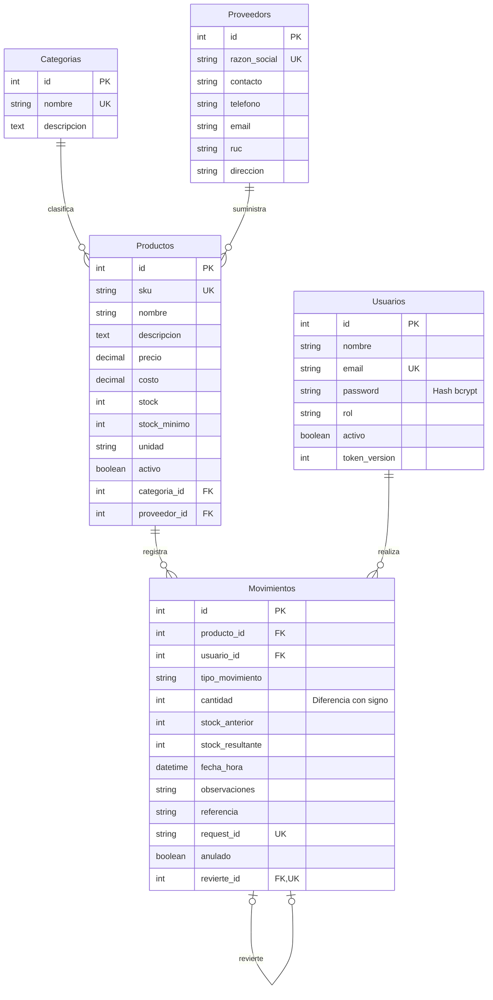

# Diagrama entidad–relación · Inventra

Sequelize agrega `createdAt` y `updatedAt` a las cinco tablas. `revierte_id` es opcional y único: un movimiento puede tener una sola reversión. Las FK de categoría, proveedor, producto y usuario usan restricción de borrado para conservar la integridad. El nombre `Proveedors` es el plural automático de Sequelize para el modelo `Proveedor`.

Invariantes del Kardex: `stock_anterior + cantidad = stock_resultante`; `stock_resultante >= 0`; la suma de todas las cantidades del producto coincide con su stock. Una anulación conserva el original y añade su inverso, por lo que ambos permanecen en el cálculo.
